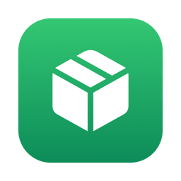
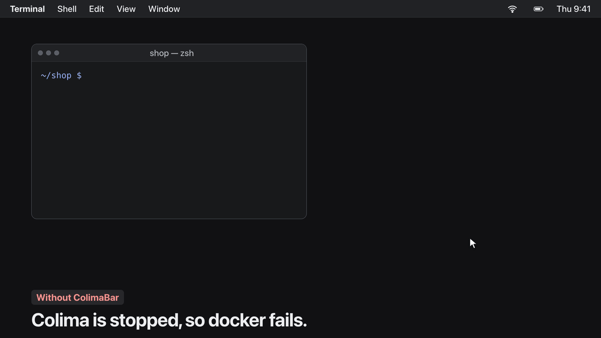
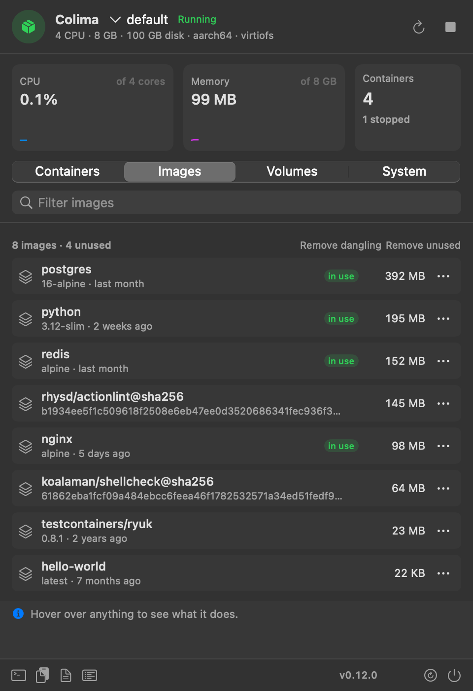
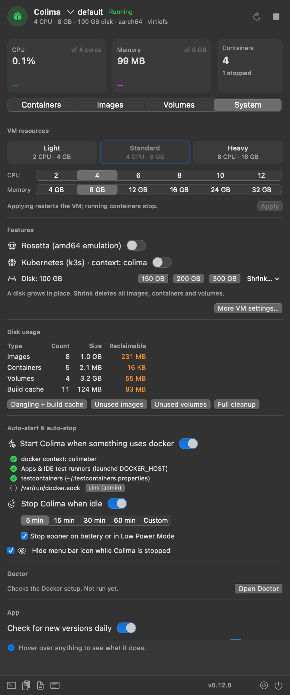
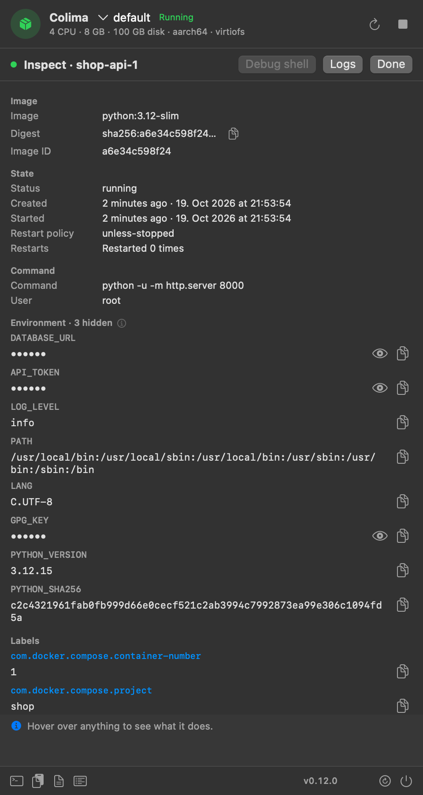
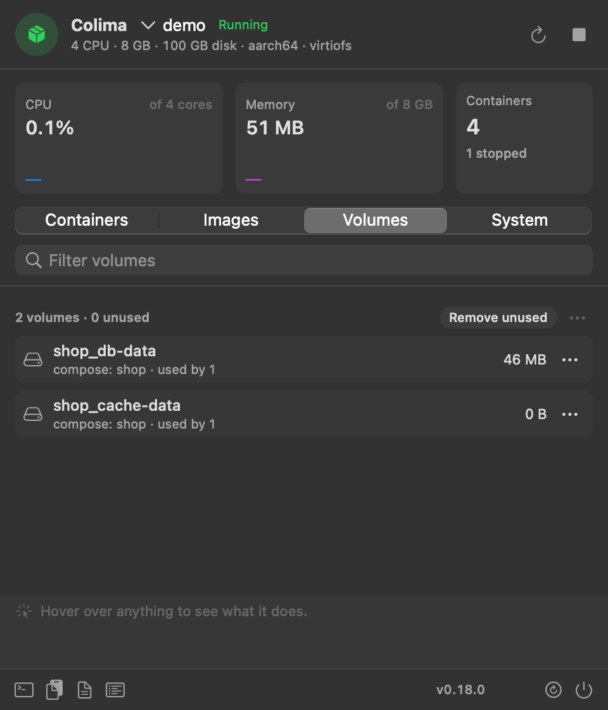
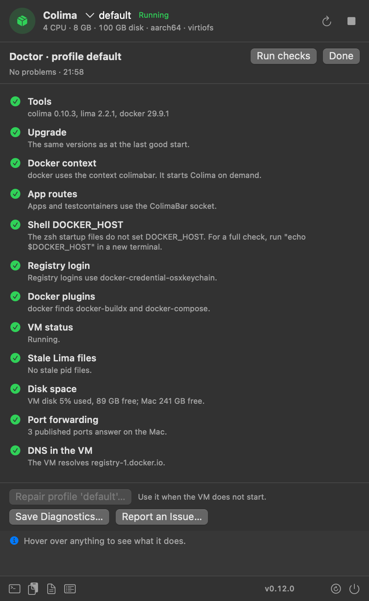
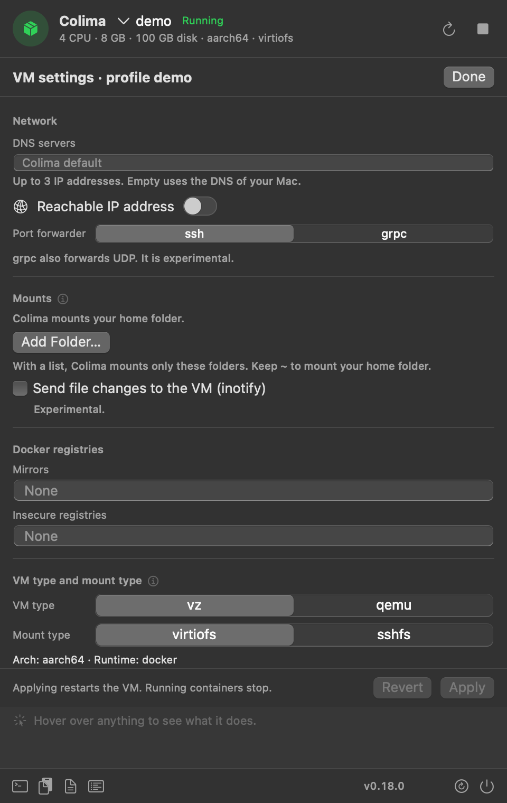
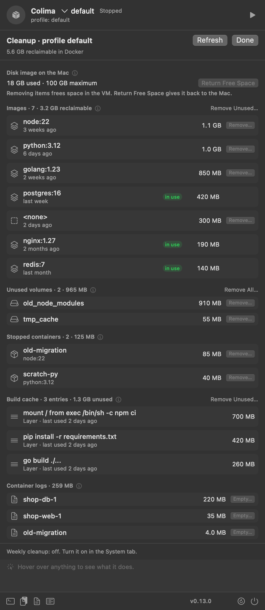
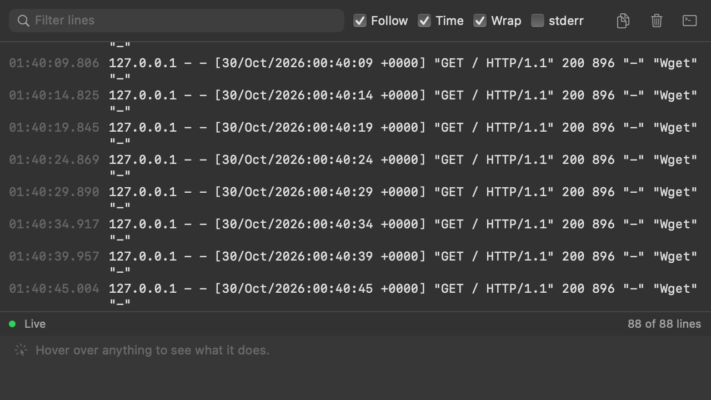

<p align="center">
  
</p>

<h1 align="center">ColimaBar</h1>

<p align="center">
  A native macOS menu bar dashboard for <a href="https://github.com/abiosoft/colima">Colima</a> that <b>starts the VM on demand</b>.
</p>

<p align="center">
  <a href="https://github.com/imohitkr/colima-bar/actions/workflows/ci.yml"></a>
  
  
  
  <a href="LICENSE"></a>
  <a href="https://github.com/sponsors/imohitkr"></a>
</p>

<p align="center">
  
</p>

- **Auto-start**: run `docker`, a test suite or an IDE test while Colima is stopped. ColimaBar starts the VM, and the command continues.
- **Live dashboard**: see containers by Compose project, with health, ports, CPU, memory and logs. Inspect a container, open a debug shell in one that has no shell, and pull, start or remove a Compose project. A stopped project has a trash button, and you choose to keep or delete its volumes. Back up and restore volumes. Images and VM settings are one click away. Change the VM type or mount type with a guided recreate (backup, image save, restore).
- **Auto-stop**: ColimaBar can stop the VM when it is idle.
- **VM type change**: switch a profile between `vz` and `qemu`, or between the `virtiofs`, `sshfs` and `9p` mounts. ColimaBar backs up the volumes and images, recreates the VM and restores what is missing.
- **Network health**: ColimaBar finds published ports that stopped answering on the Mac, and a VM that cannot resolve names after a VPN change. It offers a restart.
- **Doctor**: one click checks the docker setup (context, routes, shell, plugins, VM, disk, published ports and DNS) and fixes common problems. **Repair** gets a Broken profile running again.
- **Image updates**: find containers whose image tag has a newer version in the registry, and pull it (off by default, because it contacts registries). See [Image updates](docs/usage.md#image-updates).
- **Image scan**: scan an image for known vulnerabilities with Trivy or Grype, if you installed one (off by default). The scanner reads a temporary copy of the image and gets no docker socket. See [Image scan](docs/usage.md#image-scan).
- **Cleanup**: see the largest images, unused volumes, stopped containers, build cache and container logs, remove them one by one, and return free space to the Mac.
- **Domains**: open containers at names like `web.shop.localhost` (optional), with HTTPS from a local certificate authority and a custom suffix such as `colima.internal`. See [Container domains](docs/usage.md#container-domains).
- **Context switchers**: pick the docker context, and with kubectl the Kubernetes context and namespace, from the right-click menu. While auto-start is on, ColimaBar returns to your pick after `colima start`. See [Context switchers](docs/usage.md#context-switchers).
- **Links**: start, stop or restart the VM, or open the dashboard, from Raycast, Alfred, Shortcuts or a script with `colimabar://` links. ColimaBar asks first.
- **Shortcut**: press a keyboard shortcut that you choose to open or close the dashboard from any app. It needs no extra permission.
- **Shortcuts app**: start, stop or restart the VM, or read its state, with the action **Run Shell Script**. The command asks no question, so it suits an automation that runs without you. See [Shortcuts](docs/usage.md#shortcuts).
- **Command line**: run `colimabar status`, `start`, `stop` or `doctor` in Terminal. Add `--json` for scripts.
- **Quiet**: ColimaBar uses almost no CPU. It sends few notifications: when something fails, one when a container keeps restarting, one when a container is healthy again (off by default), when a Doctor fix ends, when a volume backup or restore ends, when Return Free Space ends, when a weekly cleanup fails, when a pull of a new image fails, when an image scan fails, when a published port or the DNS of the VM breaks, when ColimaBar refuses a link, after an auto-start that follows a Colima or Lima upgrade, one for each new version and one after an in-app update, and one the first time the icon hides.

> [!NOTE]
> ColimaBar is an independent community project. It is not part of [Colima](https://github.com/abiosoft/colima), and the Colima maintainers do not support it. Report ColimaBar problems in the [ColimaBar issue tracker](https://github.com/imohitkr/colima-bar/issues).

## Screenshots

<table>
  <tr>
    <td width="50%"></td>
    <td width="50%"></td>
  </tr>
  <tr>
    <td align="center"><b>Images</b>: sizes, images in use, prune</td>
    <td align="center"><b>System</b>: VM size, Rosetta, k3s, disk, auto-start and auto-stop</td>
  </tr>
  <tr>
    <td width="50%"></td>
    <td width="50%"></td>
  </tr>
  <tr>
    <td align="center"><b>Inspect</b>: environment with secrets hidden, mounts, ports and health</td>
    <td align="center"><b>Volumes</b>: back up and restore volumes, Compose volumes</td>
  </tr>
  <tr>
    <td width="50%"></td>
    <td width="50%"></td>
  </tr>
  <tr>
    <td align="center"><b>Doctor</b>: twelve checks, including published ports and DNS in the VM</td>
    <td align="center"><b>VM settings</b>: DNS, port forwarder, mounts and registries</td>
  </tr>
  <tr>
    <td width="50%"></td>
    <td width="50%"></td>
  </tr>
  <tr>
    <td align="center"><b>Cleanup</b>: the largest items, container logs, Return Free Space</td>
    <td></td>
  </tr>
  <tr>
    <td colspan="2"></td>
  </tr>
  <tr>
    <td colspan="2" align="center"><b>Log viewer</b>: live follow, search, timestamps and highlighted stderr</td>
  </tr>
</table>

## Install

You need a Mac with Apple silicon, macOS 15 or later, and [Colima](https://github.com/abiosoft/colima) (`brew install colima docker`).

**Homebrew (recommended).** Run this command in Terminal:

```sh
brew install --cask imohitkr/tap/colima-bar
```

Apple does not notarize ColimaBar, so macOS blocks the first launch after you install or upgrade. macOS shows "ColimaBar" Not Opened. Click **Done**. Do not click **Move to Bin**: it deletes ColimaBar. Then open **System Settings > Privacy & Security** and click **Open Anyway**. Or remove the quarantine flag: `xattr -dr com.apple.quarantine /Applications/ColimaBar.app`. If ColimaBar is gone, see [ColimaBar is gone after the macOS prompt](docs/troubleshooting.md#colimabar-is-gone-after-the-macos-prompt).

**The installer.** Run this command in Terminal. macOS does not block this download.

```sh
curl -fsSL https://raw.githubusercontent.com/imohitkr/colima-bar/main/scripts/install.sh | bash
```

**The disk image.** Download [ColimaBar.dmg](https://github.com/imohitkr/colima-bar/releases/latest/download/ColimaBar.dmg) and drag ColimaBar into Applications. Allow the first launch as described for Homebrew above.

The [Install guide](docs/install.md) has the full steps, the download check and the build from source.

### After you install

The docker CLI needs no setup. ColimaBar starts at login and switches docker to its context `colimabar`.

If your `~/.zshrc` sets `DOCKER_HOST`, replace that line with the [shell snippet](docs/auto-start.md#shell-setup). Otherwise your terminal bypasses auto-start.

## Use

- Left-click the menu bar icon to open the dashboard. Move the pointer over a control to see what it does.
- To open the dashboard from the keyboard, record a shortcut on the System tab. See [The dashboard shortcut](docs/usage.md#the-dashboard-shortcut).
- Right-click or Control-click the icon to start, stop or restart Colima, change options, check for updates, uninstall or quit.
- In Terminal, run `colimabar status`, `colimabar start` or `colimabar doctor`. Add `--json` for scripts. See [Command line](docs/usage.md#command-line).

The [Usage guide](docs/usage.md) describes the icon, each tab and each menu item.

## Update

If you use Homebrew, run `brew upgrade --cask colima-bar`. If you use the installer, run it again. ColimaBar checks for a new version each day and shows a button in the dashboard when one is available. For a copy that it can replace, the button is **Install**. It downloads the release, checks it, replaces the app and restarts, after you confirm.

## Uninstall

Right-click the menu bar icon and choose **Uninstall ColimaBar…**. Colima, your containers and your images stay.

- If the icon is hidden, open ColimaBar from Spotlight first.
- If your version does not have the menu item, [run the uninstall script manually](docs/uninstall.md#run-the-script-manually).
- If you installed with Homebrew, run `brew uninstall --cask colima-bar` after you uninstall. Do not run it first: Homebrew cannot restore your docker settings.

The [Uninstall guide](docs/uninstall.md) lists what the script removes.

## Documentation

The [user guides](docs/README.md) describe how to install, use, troubleshoot and uninstall ColimaBar.

## Contributing

Bug reports, ideas and pull requests are welcome. Read [CONTRIBUTING.md](CONTRIBUTING.md) and follow the [Code of Conduct](CODE_OF_CONDUCT.md). [ARCHITECTURE.md](ARCHITECTURE.md) explains how ColimaBar works. [CHANGELOG.md](CHANGELOG.md) lists the changes in each release.

To report a security problem, follow [SECURITY.md](SECURITY.md).

## Support

To get help, read [SUPPORT.md](SUPPORT.md).

ColimaBar is free and open source. If it saves you time, you can support its development through [GitHub Sponsors](https://github.com/sponsors/imohitkr).

## License

[MIT](LICENSE)
